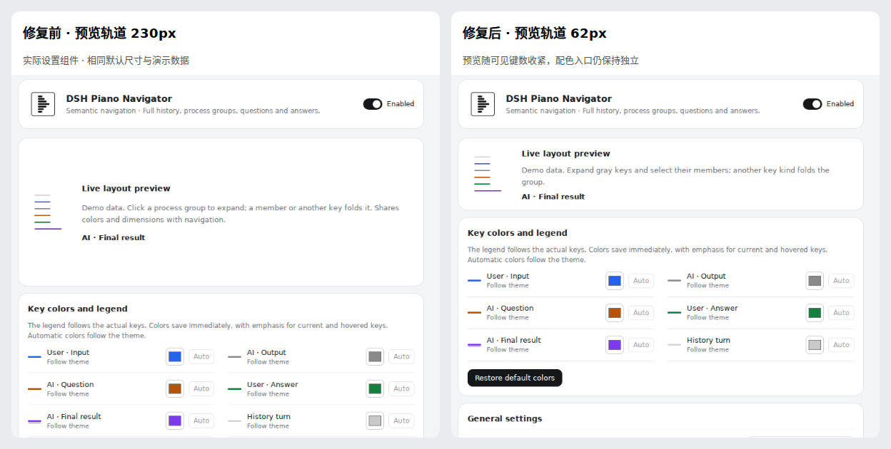

# 设置与过程灰键反馈修复（#44）

基线：`a8894d17371f7e0843d53cbb5539b4c07bc0de54`（已发布 1.3.1 的源码）。
本分支是未发布修复，不改变包版本；PR #41 横向指针实验与 #43 历史描边另行处理。

## 行为变化

- 预览按可见演示键数计算高度。默认折叠时轨道 230px → 62px，展开后 86px；
  不再为了最多 20 键的窗口预留空白。截图为实际组件的同输入对照，不是 Windows 宿主截图。
- 展开过程组后，点击/键盘激活同组成员持续定位并保持展开；切换另一组先收旧组。
  其他类型键、Escape、轨道滚轮和会话切换仍回折。
- 原颜色输入完全依赖远端已保存值。原生取色输入事件后，React 在异步保存返回前
  会立即把输入恢复为旧色；此前 `fill()` 同时发送 input/change 的检查没有覆盖这个间隙。
  现在保留最新草稿，旧保存响应不覆盖新选色，最后一次保存完成后回到持久化值；
  失败时恢复已保存颜色并显示错误。图例、预览和实际轨道在保存成功后同步。
- 移除包住整行的取色标签，只有 32×32px 色块打开取色器，语义文字/空白不触发。
  输入继续提供语义名称和键盘焦点。

## 验证证据

本次环境：Linux、Node 24.19.0，`corepack pnpm` 启动 pnpm 10.17.1；Chromium 由
Playwright 1.55.1 驱动。使用实际设置/轨道和固定版本原生 ChatView/ChatNodeSeat，
会话和设置传输为合成数据。未自动操作 Windows 系统取色器，也不代表真实用户会话验收。

- 同一 `scripts/feedback-browser.mjs`：未修改产品的基线上 6 项目标断言全部失败，
  修复后全部通过。包含普通/减少动画的连续灰键点击、键盘定位、跨组替换、Escape、
  320/390px 布局、250ms 延迟保存、旧响应晚到、失败回滚、实际背景色同步与精确取色热区。
  [基线失败记录](assets/feedback44/before.json) / [修复通过记录](assets/feedback44/after.json)。
- `corepack pnpm verify`：构建、类型和现有完整契约/集成检查通过。
- `corepack pnpm test:package`：真实 tarball 内容、离线安装和入口加载检查通过。
  此包仅用于检查，未上传或替换 npm 1.3.1。
- 实际 Chromium：反馈 6、设置 9、轨道 6、指针 11、原生语义 12、原生 ChatView 9，
  合计 53 个场景通过。原生语义检查的旧成员点击回折预期按本次交互要求更新，
  最终结果导航回折仍单独验证。

复现新回归：`node scripts/feedback-browser.mjs`。`EXPECT_BASELINE=1` 只用于检验旧产品，
要求六个断言全部失败，不能作为修复分支的正常检查模式。源码/构建/浏览器证据以本 PR 的
提交为准；合并后还需按独立发布流程交付新版本。
